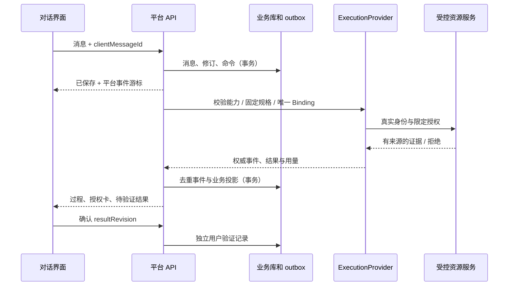

# 后台服务与前台对话执行

初始设计评审稿。用户界面维持单一对话；本页定义将来服务端如何承接，不表示已经实现后台服务。

## 服务划分与数据归属

采用模块化单体，首条链路一个受控执行节点。API、事务分派器和投影器可由一个应用部署，执行宿主作为受限子进程或隔离工作进程；不先建设分布式调度平台。

| 模块 | 拥有的数据 / 职责 | 不得越界 |
| --- | --- | --- |
| 身份与策略 | 成员、角色、授权修订、范围、审批责任 | 不信任浏览器自报身份和模型自报权限 |
| 对话服务 | 会话、消息、输入序号、待验证结果、用户确认 | 不把聊天消息 ID 当原生 Agent session ID |
| 配置服务 | 系统、环境、模型预设、接入与运行策略修订 | 不修改运行中 Binding |
| 执行协调 | 固定流程节点、预算预占、outbox、唯一 Binding、核查 | 不复制总控 Agent 分工和内部重试 |
| 材料与上下文 | 附件、代码证据、上下文清单、检索授权、记忆候选 | 不把检索结果当指令或授权 |
| Provider 适配 | 总控适配器 / 受控 ACP Host | 不与总控共用数据库或前端内部状态 |
| 资源网关 | 代码、数据、日志、MCP、文件真实访问控制 | 不靠提示词落实只读 |
| 审计与用量 | 操作事实、计量来源、配置与访问审计 | 不把估算当实际费用 |

平台关系库保存业务记录、事件与事务 outbox；对象存储保存隔离的附件和产物；检索索引仅为可重建投影。数据库产品与身份提供方留待技术评审。总控数据独立，平台只保存其外部引用。候选表：subjects、memberships、grants、configuration_revisions、conversations、messages、workflow_runs、node_runs、bindings、commands、events、approvals、attachments、artifacts、context_manifests、memory_items、usage_ledger、outbox、audit_entries。每个业务表包含 tenantId；查询索引以租户及权限范围开头。

## 一条消息如何执行

1. 登录身份在服务端解析为 subject、租户和授权修订。用户选择系统、环境和模型预设，服务端求可用交集。
2. 首条输入以 `clientMessageId` 去重，在一笔事务中写用户消息、会话修订和待处理命令，返回已保存回执；不声称已发送给模型。
3. 先判定 `purpose=understanding`：确认模型与数据外发授权，只提供获权消息 / 已授权且完成解析的附件片段，工具授权为空。需要模型追问时通过同一 Provider 契约建立本阶段独立 NodeRun / Binding 和预算预占；缺少该授权或仅收集时只返回保存回执 / 固定表单提示，不伪称已分析。
4. 理解阶段结束后，需要取证时以 `purpose=investigation` 校验代码版本、资源、隔离、模型和预算，生成固定计划，分配获授权的审批责任人；提交人不具备审批权时，前台显示“等待负责人确认”，不能自批。
5. 原子保存 NodeRun、Binding、预算预占与 start outbox。适配器用稳定命令键提交；接收未知只核查原提交。
6. 权威事件落库、去重并投影后，通过平台事件流更新前台。文本增量可以先显示“生成中”，未完成片段不作为最终证据。
7. 平台导入产物，校验 ACL、大小、哈希、证据时点与版本，交付结果修订；进入待验证。用户确认保存针对该修订的独立记录。

## 前台 API 草案

所有入口使用服务端会话或短期令牌，校验 CSRF / Origin；敏感对象逐项鉴权。命令含 `commandId, idempotencyKey, expectedRevision`，服务端生成 scope 和 subject。返回 `{data, revision, correlationId}` 或 `{error:{code,retryable,detail},correlationId}`；拒绝与未知结果分开。

| 入口 | 请求与响应要点 | 权限 / 副作用 |
| --- | --- | --- |
| GET /workbench/options | system/environment/model 过滤结果、配置和授权修订、不可用原因 | 选项读取；不泄漏未授权对象计数 |
| POST /conversations | 系统、环境、预设 ID → conversationId、revision | 新建；同键返回同一会话 |
| POST /conversations/{id}/messages | clientMessageId、text、已导入附件 ID、expectedRevision → saved / queued / waiting_input | 消息保存去重；占用节点执行中时补充材料不另起重复执行 |
| POST /conversations/{id}/inputs | 材料引用、目标 checkpoint → accepted_pending / adopted / rejected | 对应 Provider submitInput；不得声称材料一定已被当前动作采用 |
| GET /conversations/{id}/events | cursor、limit → 平台事件分页 | conversation.events.read；游标不含权限 |
| GET /conversations/{id}/stream | 平台事件游标 → SSE 增量 / snapshot_required | SSE 只是前台传输，不直接转发 MCP 流 |
| POST /conversations/{id}/stop | command、目标运行引用 → stopping / already_terminal / unknown | 不以 HTTP 200 代替停止确认 |
| POST /approvals/{id}/decision | approve / reject、operationHash、expectedRevision、理由 | 授权审批人；执行前复查；旧卡返回 PLAN_STALE |
| POST /results/{id}/verification | resultRevision、expectedInputRevision、resolved / unresolved、意见 | 仅提交人或指定验收人；重复提交不重复变更 |
| POST /attachments/import | 上传会话引用、预期 MIME/大小/哈希 → 隔离上传引用 | 大小/类型/配额、扫描与解析完成前不可进入上下文 |
| GET /artifacts/{id}/download | purpose → 短效一次用途链接 | 内容授权、完整性、保留期，撤权后拒绝续签 |
| GET /admin/records | 过滤条件、受限分页 → 脱敏元数据 | records.list；全文授权不由列表权限推导 |
| POST /admin/content-leases | 会话 ID、理由、工单引用 → 短期范围租约 | records.content.read；审计失败则拒绝读取 |
| PATCH /admin/users/{id}/grants | 基础修订、角色和环境、理由 → 新授权修订 | users.manage；禁止自我提权和越过可授予范围 |

分页 limit=1–100；内容和附件另限大小。401 未登录、403 无权、404 对不存在或不可枚举的对象统一响应、409 修订/幂等冲突、410 游标/引用过期、422 缺条件、429 超限、503 能力或依赖不可用。副作用请求超时仍以原命令键查询，不盲目自动重发。消息长度、留存、上传配额和超时默认值均由配置发布，实施前以实际能力校准。

## 事件与恢复

平台事件包含 eventId、conversationId、runId、sequence、occurredAt、receivedAt、source、causationId、schemaVersion、visibility、payloadRef。Provider 游标和平台游标分开保存；唯一约束 `(bindingId, providerEventId)` 防重复，消息流按平台 sequence 投影。乱序事件待补齐或核查快照，不直接把晚到 active 覆盖 terminal。

SSE 断开不取消后台执行；重连从持久游标恢复。游标过期返回 snapshot_required，前端重取授权快照并继续；不得新建执行。撤权时终止现有流、拒绝重连和内容引用，浏览器收到权限变化后清除可见敏感缓存。客户端刷新可恢复已保存的正式会话；当前离线原型刷新清空，不能据此宣称正式持久性通过。

输入草稿只存在本地且不进入模型。运行中新增材料排队到安全输入点；若改变当前计划，旧批准失效。停止期间保留已收到证据并展示未知用量，只有权威终态可显示已停止。后端完成与停止交错时保存最终事实，不回滚已发生动作。

## 管理与执行审计

关联链：userMessageId → platformCommandId → workflow/node/binding → provider run/session → tool invocation → evidence/artifact → resultRevision → verification。记录配置、代码、上下文和记忆修订，实际选用的模型 ID 与观测证据，不存秘密值或隐藏思维链。

配置管理员只维护配置；支持人员按理由查记录；权限管理员只授予其可管理范围；资源服务持有实际限制。详见[用户治理](USER-GOVERNANCE.md)、[模型与 ACP](MODEL-ACP-ACCESS.md)、[运行资源](RUNTIME-RESOURCES.md)。事务、崩溃恢复和并发均为待实施验收，不把离线投影当数据库保证。

## 整体走查补充

[衔接合同](END-TO-END-WALKTHROUGH.md)统一各阶段引用和失效规则。冻结的 configurationSnapshotRevision 与最近准入的 admissionPolicyRevision 分开，不能把旧配置冒充新执行。模型 / 输入 / 授权 / 工具 schema / 记忆依赖变化后，旧计划失效；实际采用模型保持独立观察，unknown 不以预设名称替代。

用户验收检查当前 inputRevision、resultRevision 及必要来源有效性。管理员记录读取同一 conversationId 的授权投影，用户消息、后台事件、产物下载和验收能关联核对；正文、附件、事件、下载仍各自授权。新增离线共同记录不代替正式业务库和事务保证。

## 首次开通服务边界

[首次开通与完整试验](FIRST-USE-AND-TRIAL.md)补充一次性管理员引导、企业身份与成员申请、成员授权事务及通知 outbox。登录成功不等于已加入组织，成员开通不等于执行批准；未开通身份不返回环境、流程或历史内容。部署健康与每个环境的执行准入分别观测。

## 标题元数据与并发更新

标题归 Conversation 所有，任务与审批投影按 conversationId 关联同一当前 title / titleRevision；历史审批快照保留原问题和条件，显示名不参与操作授权。新增命令草案 `PATCH /conversations/{id}/title`：`title, expectedTitleRevision, idempotencyKey`，返回当前标题、来源和标题修订。服务端从会话取 subject 和对象 ACL，校验 conversations.rename（默认提交人本人；协作者须另行授予），不相信前端自报角色。后台默认只同步显示，不增加一个可以独立改审批标题的字段。

标题使用独立 CAS 修订，改名和接收执行事件不互相制造业务修订冲突。同键同内容返回原决定，同键异内容拒绝；并发名称变更返回 TITLE_REVISION_CONFLICT 并保留输入供用户比较，不覆盖新名称。标题、审计、元数据更新事件 / outbox 同事务；前台与管理列表只采纳更新的 titleRevision。超时查询原命令；只重试元数据请求，不重发 start 或用户消息。

自动候选携带 conversationId、来源输入修订、基础标题修订和生成方式 / 版本。写入前复查当前 ACL、输入是否仍适用、标题是否被手工接管、细化次数以及基础标题修订；迟到候选不得覆盖手动名称或新名称。生成器失败、敏感检查不通过或模型不可用时留用安全占位标题，标题不影响执行准入。实际生成模型及预算沿已有对话的受控范围管理，不能私自新建收费模型调用。

允许同名会话；标题不是幂等键、资源定位键、审批哈希或唯一约束。标题审计保存授权范围内的已接受新旧值、来源、操作者和修订；拒绝值不落常规日志。订阅撤权后停止标题推送并清理界面缓存。离线原型只有同页记录联动和修订判断，真实服务端 CAS、跨客户端同步、内容防泄漏及持久审计仍未实现。

## 理解与取证之间的授权边界

理解和取证使用同一个执行后端接口，但各自具有用途、授权、上下文清单、计量和执行记录。业务问题维持同一 conversationId；不借一个批准扩大原 Binding，不为理解阶段另建总控引擎。

理解阶段不装配数据库 / 代码 / 日志工具，工具授权必须为空；Agent 自有终端、文件系统和网络同样由宿主与真实身份限制，不能只在 prompt 写“不要调用”。截图、附件正文以及模型提供方的数据发送范围另行许可；附件名不证明正文可发送。模型理解授权默认可由系统环境策略显式授予，用户无需每条消息再点击一份审批；敏感数据外发按更严策略确认。

理解中的模型调用和自动标题也记用途账本；仅收集不调用模型，不显示“正在分析”或生成根因结论。资源审批只批准固定取证 / 操作计划，不追溯授权此前数据外发。服务事件至少区分 `message.saved`、`understanding.queued`、`understanding.completed`、`investigation.awaiting_approval`，并投影为用户能理解的状态。新的消息或范围使旧计划失效，不能让迟到理解回调替换新计划。

切换、新建或关闭浏览器视图不产生取消命令。并发槽只在执行拥有者已接纳且未确定结束时占用；未知接收不得释放槽另投。等待用户 / 审批不产生模型请求，但保留的外部进程单独计量。原型仅用本地计时队列验证导航和排队交互，不证明服务重启、外部取消或计费停止。
