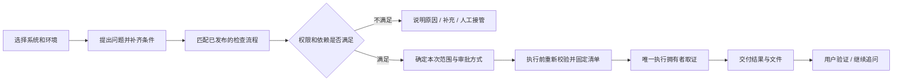

# 用户操作与后台配置如何衔接

初始设计。按用户要求复查真实产品应有的操作链，并对照历史原型收敛体验。本仓库仍只提供离线原型；下文的正式执行要求尚未通过真实接入验收。

## 两版对比与本轮取舍

| 操作 | 历史原型 | 前几轮简洁对话稿 | 本轮取舍 |
| --- | --- | --- | --- |
| 发起问题 | 独立新建页、系统环境、助手卡，再进入对话 | 在输入区选择系统环境直接提问 | 保留单一对话和快捷问题，避免重复填写 |
| 确定能做什么 | 助手 / 流程 / 系统环境的关系较直观，但很多为固定案例 | 只有系统环境和模型选项，不能看出方法和工具依赖 | 用已发布检查流程串起配置；对话显示当前已配置的检查范围 |
| 等待和补充 | 有任务状态和右侧信息，但“推进一步”等评审控件混在界面 | 自然追问较轻，但处理状态不够明显 | 保留自然追问，标题和历史显示状态；移除用户侧演练操纵 |
| 查范围、进度和文件 | 右侧上下文 / 执行事件 / 产物比较清楚 | 主要埋在消息流里 | 按需打开“问题信息”，只给业务范围、进度与结果文件 |
| 管理任务与配置 | 白卡列表、清晰工作区、流程和工具名称熟悉 | 技术评审与日常操作混杂，配置关系被拆散 | 管理端回到历史版的列表 / 卡片 / 表单，诊断下沉 |
| 验证结果 | 有独立结果页与明确验收 | 对话内验证较省操作 | 保留对话内验证；问题信息可以快速找到结果文件 |

管理端参考历史原型的任务中心和流程组织。没有恢复“总控后台”必选、任意角色切换即鉴权、固定样例冒充真实执行，以及全部 22 页必须实现的假设。原始历史文件只读保留。当前“检查流程”只维护三类固定只读模板及其依赖，没有引入自由画布、完整调度引擎或真实执行器。

## 一条用户链路

正式产品由服务端返回当前用户获权的检查候选。模型可从候选中提出计划，不能从聊天内容、自带工具或 Skill 文本创造新权限。问题不明确就追问；写入、附件解析、代码分析等不能被静默改成“报表核对”执行。本轮原型使用明确标注的脚本匹配演示，不是自然语言规划能力验收。

## 后台配置到执行的对应关系

| 配置 | 在链路中决定什么 | 当前离线原型 / 限制 |
| --- | --- | --- |
| 系统与环境 | 固定业务范围、默认模型、允许流程和资源绑定 | 首次发送后固定系统环境；新问题另建对话 |
| 用户与角色 | 环境 / 模型 / 流程范围、上传、历史、下载及本人确认权 | 对话选项和计划分别求交集；暂停或撤权使后续动作失效 |
| 检查流程 | 检查目标、所需只读工具、Skill、是否读取代码 | 三个模板：报表核对、接口排查、日志分析；草稿不生效 |
| 模型预设 | 请求模型、执行连接、Agent；实际模型需执行器确认 | 请求预设被固定；实际模型始终 unknown，不拿显示名当证明 |
| MCP 目录与环境绑定 | 哪条连接里的哪些工具可以成为候选 | 使用 connectionId + toolName，禁止另一连接同名工具自动替代；真实 schema / 身份仍未知 |
| Skill 目录与环境绑定 | 方法修订、来源和依赖 | 必须同时被流程要求、环境允许；Skill 不授予资源权 |
| 代码项目来源与环境 ref | 请求读取的项目、路径及版本 | Git 固定请求 ref；本地目录固定节点与文件快照，不使用 Git 凭据。实际 commit / 内容摘要 / 部署版本未核实时保持 null |
| 用户执行方式与环境上限 | 本人确认、负责人审批、自动只读或仅收集 | 自动模式仍须满足流程和资源依赖；仅收集不创建执行 |
| 上下文与记忆 | 本轮材料来源、摘要与经审核的记忆依赖 | 消息与记忆失效联动；附件目前仅文件名；窗口预算控件仍是评审草稿 |
| 运行环境与协议接入 | 宿主、网络、隔离、认证与真实能力准入 | 诊断页是未发布的接入评审稿；不假装其字段已经控制真实执行 |
| 预算 / 并发 | 正式分派和工具调用的限制 | 原型只记录要求和演示状态，未证明共享硬限制或真实计费 |
| 审批与结果验收 | 固定计划决定、执行前复查、独立用户确认 | 批准不等于执行完成，后端完成不等于问题解决 |

有效检查 = 当前身份范围 ∩ 角色允许流程 ∩ 环境开放流程 ∩ 流程已发布依赖 ∩ 获准模型 / Agent ∩ 已准入的真实资源能力。任一项不满足就不产生执行；unknown 不能按允许处理。

## 对话中如何确定功能

1. 系统环境变化后重新计算候选检查，只展示获权的业务名称；不让用户手动拼 MCP、Skill 或执行器。
2. 用户提问后确定检查类型并补充本轮条件。没有对应流程、流程停用、角色无权、缺工具 / Skill / 必需代码时，明确原因；可以继续说明问题，但没有批准卡和 Binding。
3. 条件齐备后形成固定的有效流程清单，记录流程修订、输入、模型预设、限定工具、Skill、代码请求 ref、上下文、当前授权 / 配置修订。对话只展示业务范围，管理诊断保留引用。“已确认”消息不替换原条件；新一轮尚无结果时，问题信息不把历史文件当作当前交付。
4. 执行方式另行判定；有具体自动授权才自动，没有本人确认权就交负责人。审批不能补足原本没有的功能或资源权限。
5. 提交执行前与每次工具调用前重新检查当前权限、计划哈希、参数、有效期和真实能力；资源服务落实限制。原执行未知时核查原拥有者，不换后端重放。
6. 文件导入和下载逐项授权；结果交付待验证。继续追问产生新输入和新计划，不能沿用旧批准或旧结果确认。

## 清单与验证边界

正式 ExecutionSpec 已有 workflowVersion、capabilitySnapshotHash、environmentResourcesRef 和 executionPolicyDecisionRef；本轮补充 effectiveWorkflowRef / Hash 关联最终限定清单。它不是前端提交的授权，而是服务端解析配置与当前策略的结果。正式模型和工具输入只注入其中获准的动作，不把环境里全部工具一次交给 Agent。

离线原型的 flowDecision 保留 configured 与 realAdmission 两个不同事实：configured 仅代表合成配置依赖齐备；realAdmission 始终 unknown、realExecutionAllowed 始终 false。脚本可以演示审批和交付，但不访问业务资源。共同契约测试、实际模型回显、工具限制、共享预算、原生审批桥和真实证据仍待实施。

浏览器用例见 [flow-links-checks.cjs](../prototype/tests/flow-links-checks.cjs)。对照截图包含历史任务 / 流程 / 对话和当前任务 / 流程 / 用户问题，仅用于设计比较。最终检查结果见[本轮报告](../reviews/initial-design-checks/README.md)。

## 统一任务标题

用户无需填写独立任务标题；首次提问自动概括，不明确时在补充后最多完善一次。对话顶部可手动重命名，手动名称不再自动覆盖。用户历史、后台任务 / 审批 / 记录共用当前标题，编号不变；改名不会修改固定执行计划或审批条件。详细行为见[交互规格](INTERACTION-SPEC.md#任务自动命名与手动重命名)，服务端独立修订见[服务执行](SERVICE-EXECUTION.md#标题元数据与并发更新)。当前自动概括为离线规则模拟。

## 配置上下文与额度贯穿执行

系统设置下管理环境。准备阶段按同一修订解析系统背景、必要项目说明和环境口径，并关联结构化资源绑定；描述不产生权限。用户实际 Agent / 模型额度从全局默认与成员例外解析，旧计划因策略或背景变化失效。管理员任务记录保留本轮上下文和额度快照，见[系统环境、执行上下文与用户额度](SYSTEM-CONTEXT-QUOTAS.md)。

## 接入治理纳入本轮准备

用户可选模型取环境允许组合、成员授权及启用连接交集；默认连接停用不自动换 Agent。准备清单固定连接、运行配置和上下文策略，管理员看到同一快照。具体操作、边界与未实现项见[接入与治理完整操作设计](ACCESS-GOVERNANCE.md)。

## 本轮可用性收敛

后台保持列表与表单，不新增主菜单。会话切换与执行解耦；新任务受跨会话并发队列限制。配置默认按对象发布，显式变更集解决跨页依赖；其他草稿保持未发布。理解模型授权与资源执行批准分开，理解阶段无业务工具，未授权时仅保存材料。额度页面显示未上报 / 可统计 / 可强制能力，不能把配置的数字当成已生效的外部硬限额。首次开通根据内部测试和敏感环境配置职责，而非一律要求企业 SSO 与第二名管理员。

三个固定只读模板是首条验证链路，不取代完整产品目标。首个可用版本仍需要真实附件解析、可配置检查方法 / Skill / MCP、代码与数据证据、结果文件、统一权限额度和用户验收；不要求先实现通用拖拽流程引擎。更复杂协作与受控变更单独验收。
