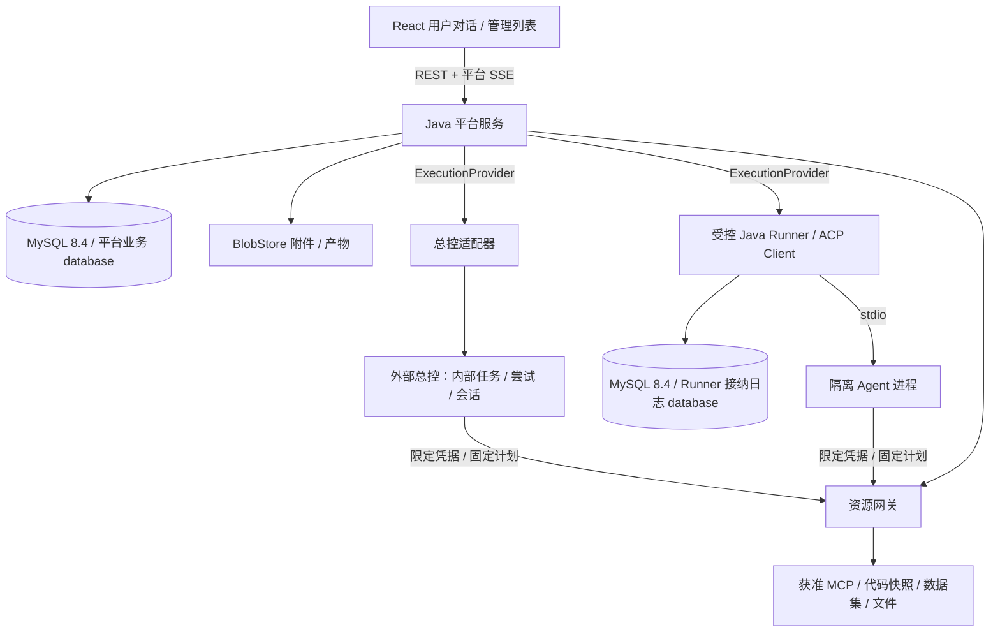

# 架构与代码层级规划

状态：开发实现待评审；平台数据库方向已确认为 MySQL 8.4 LTS / InnoDB。继承 [ADR-001](../architecture/ADR-001.md) 的独立平台方向，以一个业务单体、一个受控执行节点起步。本轮不改产品职责、执行契约或已认可的页面。

## 进程与信任边界



资源网关首批作为平台服务的独立模块和内部入口，不另建一套管理服务；它持有受控资源访问能力，Agent 仅拿绑定本轮的短效授权。Java Runner 为单独进程，Agent 为隔离子进程。两者与 Web 服务不共用管理员 OS 身份、家目录、数据库凭据或任意文件访问。

同机部署不等于同权限。平台业务库和 Runner 日志可在同一个 MySQL 实例中以**独立 database、独立账号、独立 Flyway 历史**隔离，也可分实例；示例名称为 `workbench_platform` / `workbench_runner`，不是现有资源名称。MySQL database/schema 为同一级命名空间，不照搬 PostgreSQL 库内 schema 模型。平台运行账号只访问平台库；Runner 运行账号只访问其接纳日志库，不能修改会话、审批和账本。迁移账号另行授予必要 DDL 权限，运行进程不持有管理员或跨库权限。

两库之间不做跨库 JOIN、外键、直接读写或跨进程共享事务；即使同实例具备跨库技术能力，也以 Provider 契约传递事实。备份恢复需覆盖两库及相关外部执行，不能只恢复一库就认定另一方没有接纳任务。外部总控保持独立数据库，平台不读取其 SQLite；被排查系统的 MySQL 等数据源通过资源网关接入，不与平台状态库共用凭据和事务。

Agent 不能访问 Runner 数据库或平台内部管理接口。允许的出口只包含指定模型端点和受控工具入口；文件只挂载本轮快照及输出目录。对无法禁用自带网络、MCP、终端、用户记忆的 Agent，能力标为不适用并拒绝该环境准入。容器 / 受限 OS 身份的具体组合须实测，不以目录或 worktree 代替隔离。

## 模块划分

| 业务模块 | 拥有的职责与主要用例 | 对外边界 |
| --- | --- | --- |
| identity | 登录身份、成员申请、角色、授权范围、正文租约 | `AuthorizationService`，返回当前权限与修订 |
| configuration | 系统、所属环境、模型预设、连接、资源、流程、策略的草稿与发布 | `ConfigurationQuery`、`PublishChangeSet`；发布不执行发现 |
| conversation | 对话、消息、标题、结果版本、用户验收 | 保存消息、改名、查询授权快照；不直接调用 ACP |
| execution | 理解 / 取证阶段、准备清单、节点、绑定、分派与核查 | 调用 Provider SPI；只推进固定业务阶段 |
| approval | 固定计划、责任人、决定、原生请求映射和送达 | `ApprovalService`；决定、送达和动作三种事实独立 |
| quota | 全局默认、用户模型例外、总账、预占、用量结算 | 同一事务内参与准入；不持有模型账号 |
| material | 附件、来源、上下文包、会话摘要、证据、产物与接管包 | 授权后读取 / 导入；跨会话记忆留接口默认关闭 |
| resource | 代码获取、MCP 调用策略、短效工具授权、凭据引用 | 每次调用复查实际资源权限；不让任意工具自注册后立即使用 |
| audit | 操作审计、关联查询、运维元数据 | 普通审计失败时敏感操作回滚；正文访问另行授权 |
| infrastructure | JDBC、outbox 调度、文件存储、秘密提供器、时钟、ID | 技术适配；不成为包含全部业务的公共服务 |

模块内部采用 `api / application / domain / infrastructure`，只在需要时建目录。Controller → application 用例 → domain 规则 / 端口 → infrastructure 实现。跨模块只能通过明确的 application 接口或只读查询接口，不跨包调用 Repository，不让数据库实体直接成为 HTTP 响应。多个模块参与同一业务事务，由最外层用例编排，无远程调用混入数据库事务。

审批、额度、执行的协调归 `execution.application`；它们不互相循环调用。审批决定提交后发 outbox，由执行用例重新准入；资源调用通过短效许可引用检查决定，无需让审批模块知道某个 MCP SDK。

MySQL 方言和类型转换止于基础设施层：统一 UUID 二进制映射、UTC/微秒时间映射、BigDecimal 和精确标识符绑定；Controller、领域和 provider-contract 不出现 JDBC 驱动或 JSON 列类型。运行时查询不接受用户任意表名 / SQL，不设置以总控数据库为数据源的 Repository。

## 计划目录（尚不存在业务工程）

```text
ai-test-workbench/
  docs/                           # 设计、只读历史、评审证据
  docs/prototype/                  # 当前离线原型继续保留
  backend/
    pom.xml                       # Maven 聚合与统一版本
    provider-contract/            # 平台 DTO、错误与 SPI；无 Spring/SDK/数据库
    platform-server/
      src/main/java/io/aitest/workbench/
        bootstrap/                # 启动与装配
        identity/ configuration/ conversation/
        execution/ approval/ quota/ material/ resource/ audit/
        infrastructure/           # MySQL/JDBC、outbox、共享技术设施，保持小规模
      src/main/resources/db/migration/ # 仅平台 MySQL 库的迁移
      src/test/                   # 领域、MySQL 事务、HTTP、模块依赖测试
    execution-runner/
      src/main/java/io/aitest/runner/
        admission/ journal/ acp/ sandbox/ artifact/
      src/main/resources/db/migration/ # Runner MySQL 库，独立历史表和账号
      src/test/                   # MySQL 接纳日志、子进程、协议与恢复测试
  frontend/
    src/app/                      # 路由、登录边界、全局壳
    src/features/conversation/    # 消息、材料、审批卡、结果、标题
    src/features/admin/           # executions、approvals、systems、access 等
    src/shared/api/               # 生成 DTO / API 客户端 / SSE 恢复
    src/shared/ui/                # 表格、筛选、抽屉、确认、错误反馈
    tests/e2e/
  contracts/                      # 评审冻结后生成的 OpenAPI / JSON Schema / 黄金样例
  tests/provider-conformance/     # 两条真实后端复用同一目录，不计夹具为真实通过
  deploy/                         # 获授权后才创建部署模板，不含本机私密配置
```

只有三个 Maven 模块，不把每个业务功能拆成独立服务或 Maven 工程。`platform-server` 和 `execution-runner` 只依赖 `provider-contract`，彼此不导入实现。总控适配器放在 `execution.infrastructure.provider.control`；直连代理放在同层 `direct`，调用 Runner 的内部服务。SDK DTO 均止于 adapter。

## 前端如何迁移

正式前端重新围绕服务 API 实现，把原型视为可用性与状态表现依据，不搬运全局可变对象和计时器。只缓存已授权投影；审批、额度、执行状态与命名以服务返回的 revision 为准。服务数据缓存与每会话输入草稿分开，切换路由不发送停止命令。

后台保留日常列表、搜索、筛选、分页与抽屉。环境仍在系统设置内，模型预设在 Agent 接入下，资源目录管理代码 / MCP / Skill。高级绑定、原始事件、能力证据按需展开。组件至少覆盖加载、空、无权、冲突、失效和重试查询状态；执行未知不能显示“失败后重跑”。

UI 不持有凭据或直接连接模型、ACP、MCP；配置表单只接收秘密写入回执引用。列表和对话都用 conversationId 关联标题，重命名使用 titleRevision，不更新审批计划哈希。
