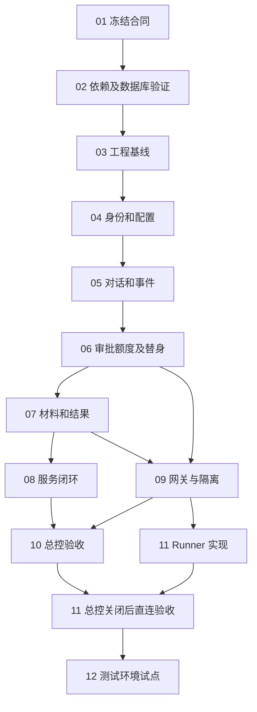

# 开发设计分析与开发步骤

日期：2026-10-26。状态：用户已授权修复设计并推进隔离环境 D0–D2，实施进行中。阶段事实见[实施记录](../reviews/IMPLEMENTATION-PROGRESS-20261026.md)；后续步骤与尚未运行的验收不得提前标记通过。

建议保留 Java 模块化单体、独立 Runner 和 MySQL 8.4 的方向，沿现有 D0–D4 分阶段推进。先冻结跨语言合同和接纳边界，再用持久化测试替身完成服务闭环，之后接总控和 ACP。首批只做一个系统、一个测试环境、一条固定只读差异检查流程；长期记忆、自由流程画布、任意 Skill 脚本、受控写入和复杂协作延后。

## 分析基线与已有内容

本次分析采用远端 main 的固定提交 [2ae5c5](https://github.com/haseakii/ai-test-workbench/commit/2ae5c516c04efcaefb2d0acbc659737effb3f1ab)。初稿分析时，本地 work 分支为 b2a700f，因命令行代理连接失败，通过 GitHub 连接器读取远端开发设计。获准开工后已保护四份未提交文档，通过受支持的工具网络权限完整 fetch 并快进至 2ae5c5，恢复全部本地新增内容。下列链接固定到原分析提交，实施变更以工作区及阶段记录为准。

| 内容 | 已有事实 | 开发时如何使用 |
| --- | --- | --- |
| 产品与交互 | 单一用户对话、系统内环境、后台列表和抽屉已有设计及离线原型 | 复用交互与状态表现，正式前端重新接服务 API |
| 执行合同 | 12 个 Provider 方法、五层状态、CP01–CP22 用例目录及 TypeScript 声明已有草案 | 冻结 schema 和可复算样例，再实现 Java DTO 与适配器 |
| 工程设计 | 三个 Maven 模块、Java 21、Spring Boot、React、独立 Runner 已有规划 | Java 方向仍待技术验证；Boot、SDK 等精确版本待 D0 冻结 |
| 数据设计 | MySQL 8.4 LTS / InnoDB 方向已确认；唯一约束、锁序、outbox、总分账及 MY01–MY14 已有设计 | 转为迁移与真实 MySQL 测试，不用 H2 或前端模拟替代 |
| 实际实现 | 本地没有业务 Maven 工程、Java 服务或迁移；远端对比新增的是设计、原型及检查材料 | 后端、真实身份、Provider、资源隔离和运维恢复都从未实施状态起算 |

离线原型和历史检查能支持交互评审，不能证明数据库事务、真实模型、ACP、MCP 或业务验收已经通过。

## 设计判断与开发前问题

以下保留初稿发现及其阻塞范围。G01–G04 已补核心类型、Schema、状态与合同验证，见[定向修复](CONTRACT-FREEZE.md)；完整接口生成及真实后端的时序保证仍按阶段验证，不提前标记完成。

职责划分合理：平台拥有业务状态、审批、预算和用户验收；Provider 拥有委派执行事实；资源网关落实真实授权。平台与 Runner 分库、分账号、分迁移历史，通过契约交换事实，有利于保持边界。首版采用单体与数据库 outbox，工程规模与当前目标匹配。

主要风险集中在平台事务与外部执行之间。数据库原子预占解决本地并发问题，但不能自动保证外部接纳、进程启动或资源操作恰好一次；这些需要明确合同及故障证据。

| 编号 | 问题与依据 | 必须补齐的内容 | 阻塞范围 |
| --- | --- | --- | --- |
| G01 | 数据设计允许有符号 BIGINT，声明中的 revision、epoch、sequence 使用 number；Provider 文本另要求安全整数 | D0 明确 API 的安全整数上界、数据库约束及越界拒绝。首批可统一不超过 JavaScript 安全整数；需要更大范围时另定字符串合同，不能静默转型 | 步骤 03 前冻结 |
| G02 | 已指定 RFC 8785，但 examples.json 的哈希是占位值，内部 ID 也是 demo 字符串；尚无 Java/TS/MySQL 可复算往返证据 | 按内部 UUID 与外部不透明 ID 分型；冻结微秒时间、Decimal 字符串、null、数组顺序和摘要输入域。加入重复键、Unicode、数值边界及往返黄金样例 | 步骤 03 前冻结；实验在步骤 02 验证 |
| G03 | BusinessApprovalRecord 支持 authority=policy，但 ApprovedOperation 仍必填 approverSubjectId，未明确自动决定如何表达 | 统一决定与获准操作的身份合同，区分人工审批人、授权签发人及策略服务身份；不填入虚构人工签字 | 步骤 06 前冻结 |
| G04 | 文档要求出队、发送及首次接纳前复查期限，但 start 只有固定 ExecutionSpec 等引用，尚未明确接纳端如何验证批准期限和当前准入 | 定义接纳凭据或等价协议、校验方、时钟误差、拒绝回执，以及发送延迟后的处理。CallContext.deadline、执行 deadline、批准期限分别表达；资源调用处继续复查当前权限 | 步骤 06 用替身验证；真实自动分派前必须验证 |
| G05 | 总控当前制品、SDK、幂等查询、最终封闭、审批桥及二进制能力没有本轮实测 | D0 形成目标版本与能力差距表；D3 对实际制品验证。缺能力则该路径阻断或人工核查，适配器本地日志不能补造外部事实 | 阻塞对应 D3 路径，不阻塞 D1/D2 |
| G06 | 硬调用次数、Token、实际模型及子调用覆盖取决于目标 Agent 和强制网关 | 区分已验证硬限制与平台轮次限制；未知计量例外仅适用于获准的非硬限额流程。辅助理解、标题和摘要同样计量 | 阻塞要求硬限额的真实流程 |
| G07 | MySQL 锁序、未关闭 Binding 唯一性、跨 NodeRun 重试与旧拥有权检查仍只有设计 | 将约束、稳定守卫行、CAS 和证明要求落实到 SQL；测试两个请求创建新节点时也不能绕过旧未决执行。Runner 另验接纳与进程启动窗口 | 步骤 06 与 11 的退出条件 |

G01–G04 可由工程负责人在既定方向内提出合同修订并评审，无需逐项询问普通实现细节。G05–G06 是目标能力的事实问题，应以验证解决。身份源、试点环境和资源授权留到对应阶段确定。

历史复审记录仍包含 PostgreSQL 及设计分支待合并表述。当前数据库方向以 ADR-002、数据库决定和 docs/development 为准；历史过程不覆盖当前决定。后续将本计划纳入最新 main 时，应保留这些来源的时间语境。

## 按依赖排序的开发步骤

以下路径均为拟建工程位置。每步交付需包含对应失败路径和证据，不能只按页面是否出现判断完成。

### 步骤 01 冻结最小合同

阶段 D0。前置：确认首批固定只读流程。模块：contracts、backend/provider-contract 的合同规划。

交付 OpenAPI、Provider 与事件 JSON Schema、状态和错误映射、规范化与哈希规则、身份和时间数值约定；解决 G01–G04。合同指定唯一生成或校验来源，避免 Java、TypeScript 和声明各自演变。将 CP01–CP22 映射到方法、所需能力和预期回执。

验收：可逐字段审查 start、lookup、close、权限决定、事件与结果确认；明确已保存、已批准、已接纳、已执行及用户确认之间的区别。此步完成合同草案冻结，不声称已编译或运行通过。

### 步骤 02 完成依赖与数据库最小验证

阶段 D0。前置：步骤 01 的候选合同。模块：隔离兼容验证工程、数据库实验及协议夹具。

交付精确 JDK、Boot BOM、Connector/J、Flyway core/mysql、ACP/MCP SDK、前端工具链版本及可复现清单。用合成数据验证真实 MySQL 8.4 的空库迁移、类型、唯一约束及 Java/TS 黄金样例；协议先用受控夹具，不需付费模型或业务资源。编制目标总控与 Agent 能力差距表，未知项保留未知。

验收：完成 MY01–MY03、MY09–MY10 的最小语义实验；记录数据库配置及版本。黄金样例两端输出和哈希相同，非法输入明确拒绝。验证失败时选择受支持组合后重验，不盲目冻结候选版本。

### 步骤 03 建立工程与迁移基线

阶段 D1。前置：步骤 01–02。模块：backend 下 provider-contract、platform-server、execution-runner 三个 Maven 模块，以及 frontend。

交付 Maven Wrapper、前端锁文件、CI、配置与秘密引用接口、时钟与 ID 端口、平台及 Runner 独立迁移入口。按闭环需要逐步建表，不一次迁移全部远期对象。Runner 此时只建壳，不启动 Agent。

验收：空库启动、增量升级、重启数据保持、迁移失败不就绪；模块依赖检查阻止平台与 Runner 导入对方实现。运行账号不能 DDL 或跨库读写，覆盖 MY01、MY13 的对应部分。

### 步骤 04 实现身份门禁与最小配置

阶段 D1。前置：步骤 03。模块：identity、configuration、audit。

交付服务端 Scope、成员与授权修订、系统下环境、固定流程、测试连接和模型配置、对象草稿及显式发布。开发测试身份只能在测试配置启用；启动真实环境时启用测试身份应失败。发现先留端口，不在保存或发布配置时偷偷连接外部服务。

验收：未开通零环境权限，跨用户及跨租户引用被拒绝，不能自我提权；发布 CAS 和依赖交集生效，未选草稿保留。只有已发布且获权对象进入 workbench/options。

### 步骤 05 实现持久对话与平台事件

阶段 D1。前置：步骤 04。模块：conversation、execution 的输入入口、material 的引用接口。

交付会话固定系统环境、消息幂等、inputRevision、独立 titleRevision、命令查询、平台事件分页与 SSE。理解用途单独建记录和授权边界；D1/D2 用脚本化替身验证追问，不伪装真实模型理解。仅收集模式不调用 Provider。

验收：同消息重发不另建执行；多标签改名发生可恢复冲突；刷新和 SSE 断线从持久游标恢复，切页不取消。并发事件提交不漏序，覆盖 MY03、MY11。

### 步骤 06 实现审批额度与持久执行替身

阶段 D1。前置：步骤 04–05，G03–G04 已明确。模块：execution、approval、quota、outbox/inbox、测试 Provider。

交付固定计划、prepared Binding、责任人审批、总分账与并发预占、出队重新准入、命令去重、接纳核查、停止和安全关闭。持久测试替身支持丢回执、延迟接纳、重复事件、封闭竞争和进程事实模拟；它只在测试中使用，不标记真实能力 verified。

验收：两个请求抢最后一槽或预算仅一个成功；审批过期、撤权及相关依赖改变后不新分派；同键异内容冲突。覆盖 MY02–MY08、MY11 以及适用 CP 用例。注入提交前后、sending 后和回执落库前崩溃，仍恢复原 Binding；not_found、租约超时及停止请求均不释放未知占用。

### 步骤 07 实现材料取证与结果交付

阶段 D2。前置：步骤 05–06。模块：material、resource 的受限合成夹具实现、conversation 的结果与验收。

交付真实上传、隔离扫描解析、上下文清单、合成数据读取、确定性差异工具、证据、BlobStore 产物导入、用户验证及接管包。初期通过受限夹具驱动调用工具；Provider 替身提供执行交互，差异计算必须实际运行，不能用预写答案替代。

验收：文件 ready 前不能进入上下文；输入、算法和产物哈希可复算；单位、时区、重复键、截断及公式注入有明确处理。哈希失败拒绝下载；无权用户及过期正文租约被拒绝。用户针对当前 resultRevision 确认，新增输入使旧结果不能直接确认解决。

### 步骤 08 完成正式前端与合成数据服务闭环

阶段 D2。前置：步骤 04–07。模块：frontend 对话、系统配置、成员、审批、执行及记录列表。

交付正式 SPA 连接本地业务服务，贯穿创建配置、成员获权、提问补条件、负责人审批、只读差异计算、下载和用户验证。保留系统内环境、列表及抽屉的交互；高级协议按需展开。前端按服务修订显示，不复制原型全局状态作为业务真相。

验收：按下一节的合成夹具完成完整 E2E；重启、刷新、多标签和断流不重复启动。另一身份不能读取会话正文、附件、事件或文件。此时通过的是服务与合成数据闭环，真实 Provider 仍未验收。

### 步骤 09 落实资源网关与执行隔离

阶段 D3。前置：步骤 06–07；真实接入试验取得对应身份和资源范围。模块：resource、秘密提供器、运行隔离模板。

交付短效操作许可、当前授权复查与单次消费、代码快照、受控 MCP 工具及参数白名单、秘密引用和审计；先支持一种代码来源和本流程必需工具。理解、标题及摘要工具集为空，也要禁止 Agent 自带终端、网络或私有记忆绕过限制。

验收：用真实 OS、网络和工具拒绝回执证明越权不能发生；覆盖目录链接逃逸、Token 不进入命令行/日志、MCP schema 漂移和授权撤销。无法控制自带能力的 Agent 不准入。

### 步骤 10 验证总控适配路径

阶段 D3。前置：步骤 02 的差距表、步骤 08–09；获权目标总控制品与端点。模块：execution.infrastructure.provider.control。

交付正式外部入口适配、固定版本、能力观察、原键查询与封闭、持久事件、权限桥及二进制导入。平台只持外部引用，不访问总控 SQLite，也不修改现有总控项目。必要能力缺失时交付明确缺口及阻断结果；需要对方改动须另定任务。

验收：CP01–CP21 按目标能力逐项留真实证据，unsupported 与未运行保留原状态；首批必需项不得以跳过代替通过。对同一合成夹具实际取证、计算、交付和用户确认，验证费用与模型观察来源。

### 步骤 11 验证 ACP Runner 独立路径

阶段 D3。前置：步骤 06、09；最终独立验收排在步骤 10 之后。模块：execution-runner 的 admission、journal、acp、sandbox、artifact，以及平台 direct 适配。

交付独立接纳日志、stdio 会话、能力协商、模型观察、权限桥、取消与子进程核查。先落接纳事实再启动；日志不能证明进程未启动时保持未知。旧 worker 租约失效后的 fencing 要在接纳和资源侧落实，不能只更换数据库字段。

验收：真实 MySQL 上覆盖 MY12 及 MY13；逐项共同 CP 测试。明确停止总控后，以同一夹具和相同授权/预算约束通过 CP22；保存总控停用证据与 Runner 进程、工具和产物事实。只过总控或只过直连均不能宣称两路支持。

### 步骤 12 完成获权测试环境试点

阶段 D4。前置：步骤 08–11 及试点条件确认。模块：真实身份接入、配置与资源、备份恢复、运维和用户验收。

交付一套选定身份方式、指定系统环境和数据范围、审批及验收责任人、预算、制品和秘密管理、监控及恢复手册。先读取合成夹具，再进入获权测试数据；分别保留两类证据。部署与资源试验只在对应授权范围内进行。

用户要求部署简单，步骤 12 同时交付一条普通使用者首装路线和单一操作入口，按 [D4-DEPLOY 简单搭建验收](IMPLEMENTATION-PLAN.md#简单搭建交付验收d4-deploy用户首装待验收) 约束必填输入、运行单元、预检/初始化、停止/重启、升级和失败恢复。已有获准合成环境的统一入口、配置模板、只读预检和安全停启自动化，见[运行说明](../../backend/README.md)；这是提前推进的交付准备。当前内部配置不是最终用户首装流程，目标已确定为Windows电脑，发行入口/ZIP准备中，完整首装/升级/备份恢复仍待验收；不创建未获批的新资源。

验收：MY14 完整恢复平台库、Runner 日志、文件与秘密引用；恢复后冻结分派，核查外部未决执行再放行。责任人确认 RPO/RTO、接管方式与试点结果，测试人员能复算结果；失败与未运行项保留。

## 第一个可验证闭环

步骤 06 先形成工程检查点：保存消息 → 固定计划 → 审批 → 原子预占 → 测试 Provider 接纳 → 事件持久化 → 重启恢复原执行。它优先暴露重复分派、额度与审批竞态。

首个完整业务检查点在步骤 08：一个测试成员、一个负责人、一个系统和测试环境、一条已发布差异流程、一个持久测试 Provider。真实服务处理合成数据，不需要真实模型、SSO、GitLab 或业务数据库。条件通过结构化输入或脚本化追问补齐，不将替身当成模型能力证明。

合成订单明细金额为 O001=100.00、O002=200.00、O003=50.00；报表对应为 100.00、190.00、70.00，币种与时间范围相同。规定差额为报表减明细，预期两条差异分别为 -10.00、20.00，总差额 10.00。用 BigDecimal 的真实计算输出 CSV 与来源清单。

按以下顺序验收：

1. 管理员发布环境、固定流程与只读夹具权限，成员申请并获权；未开通身份看不到环境。
2. 用户上传两份 CSV，补齐时区、区间、状态和币种；文件解析完成后生成固定计划。
3. 负责人在审批列表处理该计划；无审批权的提交人不能自行批准。
4. 批准后出队重新准入，一次预占、一次接纳；测试替身触发受限夹具工具实际计算。
5. 平台导入并校验 CSV、输入和来源哈希，进入待验证；下载需要当前权限。
6. 用户复算两条差异并确认当前结果版本，管理员按同一 conversationId 查到审批、执行及结果元数据。
7. 重启服务及重复提交后仍只有原执行和一次用量入账；另一个用户访问正文、事件、附件和下载均被拒绝。

同时运行批准后过期、发送回执丢失、用户撤权、哈希失败、晚到事件及用户选择未解决等失败场景。以命令键、Binding、审批哈希、数据库记录、工具调用及文件摘要证明结果，不只依赖页面截图。

## 并行与串行边界

合同初稿确定后，可并行准备 Java 依赖、MySQL 最小实验与前端组件选型，结果一起冻结。步骤 04 的身份与配置可按稳定接口并行；步骤 05 开始后，前端可针对合同开发，最终联调仍依赖步骤 06–07。步骤 09 取得资源接口后，总控和 Runner 的内部实现可并行；真实验收保持先总控、后停总控验证直连的顺序。

审批、额度、命令、Binding 和 outbox 的事务用例须由一个编排入口统一，不能拆成各自独立提交。平台与 Runner 两库始终通过契约协调。任何接纳、送达或副作用未知的执行均保留原拥有权，不通过并行另投来恢复。

## 需要用户决定的事项

| 决定 | 建议 | 最晚需要确定的时点 |
| --- | --- | --- |
| 下一阶段实施范围 | D0–D2 隔离实施已获明确授权并进行中；真实接入另按 D3 范围推进 | 当前按实施记录推进，不重复请求同一授权 |
| 首批真实身份方式 | 在现有企业 OIDC 或成熟邀请账号方案中选一种；D1 测试身份不因此阻塞 | D4 真实登录接入前，D0 先确认接口与部署约束 |
| 总控和 Agent 目标 | 指定受支持制品、端点、模型账号和预算负责人 | D0 差距表可先记未知；对应 D3 试验前必须确定 |
| 试点资源与责任 | 一个测试系统环境、指定数据集、审批人、验收人及明确自动只读范围 | D3 实际访问前；默认不额外授予自动只读 |
| 数据及运维要求 | 长期记忆默认关闭；确定文件保留、正文审阅、备份与恢复目标 | D4 前冻结；D1 使用合成配置验证接口 |

精确依赖补丁、DTO 生成工具、组件库、索引长度和线程池参数由工程验证决定，记录取舍即可，不全部转成用户阻塞。团队人数和可用工时尚不明确，当前以依赖及退出条件排步骤，不承诺日历工期。

## 验证与交付要求

每步保存提交与依赖清单、范围、输入、预期及实际结果、失败与未运行项。数据库项沿用 MY01–MY14，Provider 项沿用 CP01–CP22；按阶段记录部分完成，不能用一次连接成功标记整项通过。CP22 的总控路径列应按用例适用性说明，其核心证据是停总控后的直连运行，不伪造总控执行此项。

计划初稿阶段只新增计划及入口文档，检查范围限于来源、链接、差异及静态一致性。用户随后明确授权隔离 D0–D2 实施；Java/MySQL 的实际新结果见实施记录，真实 Provider 与外部部署仍未运行。工作区修改未提交或推送。

本轮来源核对的 16 份远端文本与 GitHub 返回的 Git blob 哈希一致；本计划及三份入口文档的 104 个本地链接存在。基于本地 b2a700f 运行 check_initial_design.py，通过 506 项静态检查；verify_sources.py 确认 20 份历史 UTF-8 源稿 SHA-256 未变。另核对 12 步顺序和差异格式。这些检查不覆盖远端新原型回归或未来工程运行。

## 开发设计来源

以下固定链接共同限定本次分析的来源版本：

- [开发设计入口](https://github.com/haseakii/ai-test-workbench/blob/2ae5c516c04efcaefb2d0acbc659737effb3f1ab/docs/development/README.md)
- [技术选型](https://github.com/haseakii/ai-test-workbench/blob/2ae5c516c04efcaefb2d0acbc659737effb3f1ab/docs/development/TECH-STACK.md)
- [架构与代码层级](https://github.com/haseakii/ai-test-workbench/blob/2ae5c516c04efcaefb2d0acbc659737effb3f1ab/docs/development/ARCHITECTURE-AND-CODE.md)
- [数据与事务](https://github.com/haseakii/ai-test-workbench/blob/2ae5c516c04efcaefb2d0acbc659737effb3f1ab/docs/development/DATA-AND-TRANSACTIONS.md)
- [接入与 API](https://github.com/haseakii/ai-test-workbench/blob/2ae5c516c04efcaefb2d0acbc659737effb3f1ab/docs/development/INTEGRATION-AND-API.md)
- [原实施计划及 MySQL 验收目录](https://github.com/haseakii/ai-test-workbench/blob/2ae5c516c04efcaefb2d0acbc659737effb3f1ab/docs/development/IMPLEMENTATION-PLAN.md)
- [Provider 声明](https://github.com/haseakii/ai-test-workbench/blob/2ae5c516c04efcaefb2d0acbc659737effb3f1ab/docs/design/contracts/execution-provider.d.ts)与[摘要及字段规则](https://github.com/haseakii/ai-test-workbench/blob/2ae5c516c04efcaefb2d0acbc659737effb3f1ab/docs/design/EXECUTION-PROVIDER.md)
- [技术栈与数据库决定](https://github.com/haseakii/ai-test-workbench/blob/2ae5c516c04efcaefb2d0acbc659737effb3f1ab/docs/architecture/ADR-002.md)与[数据库决定记录](https://github.com/haseakii/ai-test-workbench/blob/2ae5c516c04efcaefb2d0acbc659737effb3f1ab/docs/reviews/DATABASE-DECISION-20261026.md)
